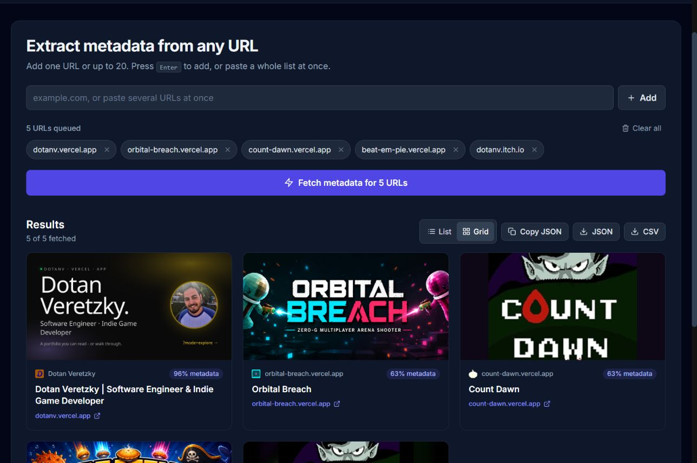
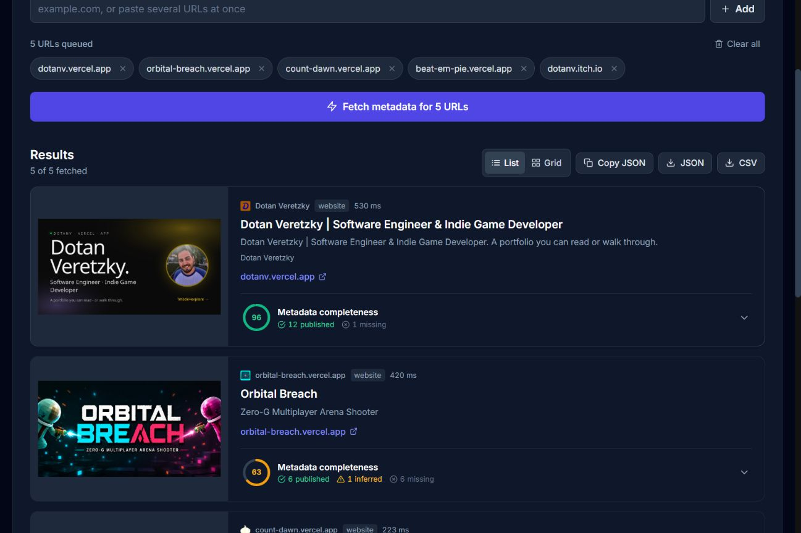

# 🌐 URL Metadata Fetcher

**Inspect, preview and audit the metadata behind any public URL.** Fetch one page or a batch of twenty, compare the tags each page publishes, inspect full-size preview images and export clean JSON or CSV.

[](https://github.com/DotanVG/react-node-url-metadata-fetcher/actions/workflows/ci.yml)
[](https://app.netlify.com/sites/react-node-url-mdata-fetch-dotanv/deploys)
[](LICENSE)

**[▶ Live app](https://react-node-url-mdata-fetch-dotanv.netlify.app/)** · **[API](https://react-node-url-metadata-fetcher.onrender.com/)**

---

## Table of contents

- [What it does](#what-it-does)
- [Screenshots](#screenshots)
- [Architecture](#architecture)
- [Quick start](#quick-start)
- [Configuration](#configuration)
- [API reference](#api-reference)
- [Auditing a single-page app](#auditing-a-single-page-app)
- [Error codes](#error-codes)
- [Testing](#testing)
- [Security](#security)
- [Deployment](#deployment)
- [Project layout](#project-layout)
- [Contributing](#contributing)
- [Origin](#origin)
- [License](#license)

## What it does

Give it a URL. It fetches the page, parses the markup and returns the metadata that page publishes about itself. Extraction prefers **Open Graph**, then **Twitter Cards**, then **JSON-LD**, then plain HTML, which is the order publishers usually curate.

- **One URL is enough.** Add a single link or batch up to 20.
- **Paste a whole list.** Newlines, commas, semicolons and spaces are split into separate URLs.
- **No scheme needed.** `example.com` becomes `https://example.com/`.
- **Nothing hides a failure.** A bad link comes back as its own error card with a plain-English reason; the rest of the batch is unaffected.
- **Wakes the API on load.** The backend sits on a free tier that sleeps after 15 minutes. The app pings it the moment the page opens and shows exactly what is happening while it boots, so your first click is never the one that waits.
- **Analyzes the tags, not just the values.** Every result includes a metadata analysis showing which tags the page publishes, which values were inferred and which tags are absent. Each gap includes the tag needed to fix it.
- **Flexible image-first results.** Switch between a detailed list and a compact desktop grid. Click or tap a thumbnail to inspect the complete image in the center of the screen.
- **Export anywhere.** Copy as JSON, or download JSON/CSV (properly escaped, and hardened against spreadsheet formula injection).
- **Dark mode**, full keyboard support, and a layout that works on a phone.

## Screenshots

| Image grid | Detailed list |
| --- | --- |
|  |  |

The grid keeps preview images prominent and shows Metadata Analysis on every card. Select the analysis row or the card body to open the full result and metadata audit. The list view exposes descriptions, timing, destination links and the complete audit directly.


The full image preview opens only after a click, keyboard activation or tap. Close image and detail dialogs with their X button, the Escape key or a click outside the dialog. Mobile always uses the detailed list view.

## Architecture

```
┌────────────────────┐        POST /fetch-metadata        ┌──────────────────────┐
│  React + Vite SPA  │ ─────────────────────────────────▶ │  Express API         │
│  (Netlify)         │ ◀───────────────────────────────── │  (Render, free tier) │
│                    │        { results, summary }        │                      │
│  • wakes API on    │                                    │  • SSRF guard        │
│    load via /health│        GET /health                 │  • per-hop redirect  │
│  • text rendered   │ ─────────────────────────────────▶ │    revalidation      │
│  • JSON/CSV export │                                    │  • timeout + size cap│
└────────────────────┘                                    │  • cheerio parsing   │
                                                          └──────────┬───────────┘
                                                                     │ HTTPS
                                                                     ▼
                                                              the public web
```

**Backend:** Node.js 24 LTS+, Express 4, Cheerio. No database; every request is stateless.

**Frontend:** React 18, Vite 6, Tailwind CSS 3. Uses the platform `fetch`, so there is no HTTP client dependency.

## Quick start

**Requirements:** Node.js 24 LTS or newer. Both the frontend and backend declare Node 24+ in their `engines` fields; `.nvmrc` files select Node 24. Node 24 ships with npm 11, which is suitable for the included lockfiles.

```sh
git clone https://github.com/DotanVG/react-node-url-metadata-fetcher.git
cd react-node-url-metadata-fetcher
```

Run the API:

```sh
cd Backend
npm install
npm start          # http://localhost:3000  (npm run dev to watch for changes)
```

Then, in a second terminal, run the app:

```sh
cd Frontend
npm install
npm run dev        # http://localhost:5173
```

The frontend talks to `http://localhost:3000` by default. To point it elsewhere, copy `Frontend/.env.example` to `Frontend/.env` and set `VITE_API_URL`.

## Configuration

Every knob is an environment variable; see `Backend/.env.example` and `Frontend/.env.example`.

### Backend

| Variable | Default | Purpose |
| --- | --- | --- |
| `PORT` | `3000` | Port to listen on |
| `ALLOWED_ORIGINS` | localhost + the deployed site | Comma-separated browser origins allowed by CORS |
| `MAX_URLS_PER_REQUEST` | `20` | Batch size limit |
| `FETCH_TIMEOUT_MS` | `10000` | Per-URL network budget |
| `MAX_HTML_BYTES` | `2097152` | Body size cap (2 MB) |
| `MAX_REDIRECTS` | `5` | Redirect hops before giving up |
| `FETCH_CONCURRENCY` | `5` | Parallel fetches per batch |
| `RATE_LIMIT_WINDOW_MS` | `60000` | Rate-limit window |
| `RATE_LIMIT_MAX` | `30` | Requests per window, per IP |
| `ALLOW_PRIVATE_ADDRESSES` | `false` | **Local development only.** Permits loopback/RFC1918 targets. Link-local and multicast stay blocked regardless. |

### Frontend

| Variable | Default | Purpose |
| --- | --- | --- |
| `VITE_API_URL` | `http://localhost:3000` | Base URL of the API |

## API reference

### `GET /`

Describes the service, its endpoints and current limits.

### `GET /health`

Liveness probe, and the endpoint the frontend uses to wake a sleeping instance. **Deliberately exempt from rate limiting**, so a wake-up ping can never lock a user out of the endpoint they are about to use.

```json
{ "status": "ok", "uptimeSeconds": 42, "timestamp": "2024-05-01T10:00:00.000Z" }
```

### `POST /fetch-metadata`

```http
POST /fetch-metadata
Content-Type: application/json

{ "urls": ["https://nodejs.org", "https://github.com/DotanVG"] }
```

Responds `200` with one result per URL, **in the order they were sent**:

```json
{
  "results": [
    {
      "url": "https://nodejs.org/en/about",
      "ok": true,
      "finalUrl": "https://nodejs.org/en/about",
      "status": 200,
      "elapsedMs": 175,
      "title": "Node.js | About Node.js®",
      "description": "Node.js® is a free, open-source, cross-platform JavaScript runtime environment that lets developers create servers, web apps, command line tools and scripts.",
      "image": "https://nodejs.org/en/next-data/og/announcement/Node.js%20%E2%80%94%20About%20Node.js%C2%AE",
      "imageAlt": "The Node.js Hexagon Logo",
      "siteName": "nodejs.org",
      "favicon": "https://nodejs.org/static/images/favicons/favicon.png",
      "type": "",
      "author": "",
      "publishedAt": "",
      "canonicalUrl": "https://nodejs.org/en/about",
      "locale": "en-GB",
      "themeColor": "",
      "keywords": [],
      "sources": {
        "title": "og",
        "description": "og",
        "image": "og",
        "imageAlt": "twitter",
        "siteName": "derived",
        "favicon": "html",
        "type": null
      },
      "audit": {
        "score": 71,
        "published": 7,
        "inferred": 1,
        "missing": 5,
        "total": 13,
        "missingEssential": [],
        "fields": [
          {
            "key": "title",
            "label": "Title",
            "tag": "og:title",
            "importance": "essential",
            "hint": "The headline every platform shows. Without og:title the page falls back to <title>.",
            "status": "published",
            "source": "og"
          }
        ]
      }
    }
  ],
  "summary": { "requested": 1, "succeeded": 1, "failed": 0 }
}
```

Fields a page does not publish come back as empty strings rather than being omitted, so every result has the same shape. `sources` and `audit.fields` are abridged above. `sources` names every field, and `audit.fields` carries one entry per audited tag.

### Metadata audit

Each successful result carries an `audit` grading what the page publishes.

**`sources`** names where each value actually came from: `og`, `twitter`, `jsonld`, `html`, or `derived`. That last one matters. `derived` means *we* worked the value out and the page never published it. `siteName` falls back to the hostname and `favicon` to `/favicon.ico`, so both are commonly `derived`.

`favicon` is chosen by the `rel` value, in this order, and the first usable `href` wins:

1. `icon`
2. `shortcut icon`
3. `alternate icon`
4. `apple-touch-icon`
5. `mask-icon`

The match is the exact `rel` on the tag (`link[rel="icon"]` and the rest in `findFavicon`). When a relation appears more than once, the first tag in the document is used. Size is ignored, so a large `apple-touch-icon` stays a fallback: a page that declares both `rel="icon"` and `rel="apple-touch-icon"` reports the `rel="icon"` address, even when the touch icon comes first in `<head>`. An `href` that is not `http:` or `https:` is skipped, which drops `javascript:` and `data:` URLs.

Any of those declared tags sets `sources.favicon` to `html`. The source names the kind of markup, and it does not name which relation won. With no usable declared icon, the value is `/favicon.ico` resolved against the page URL and `sources.favicon` is `derived`. The audit then marks favicon as inferred. `locale` only ever comes from `og:locale`; `<html lang>` is not the same thing and is not used.

The API reads the raw HTML the server returns, the same way social crawlers do. See [Auditing a single-page app](#auditing-a-single-page-app).

**`audit.fields[].status`** is one of:

| Status | Meaning |
| --- | --- |
| `published` | The page declares this tag |
| `inferred` | We filled it in; the page never said |
| `missing` | Absent entirely |

**`audit.fields[].importance`** is `essential` (title, description and image; the preview breaks without them), `recommended`, or `optional`. The score weights them 3 / 2 / 1 and gives an inferred value half credit, so a page cannot score well by publishing a dozen trivial tags and no `og:image`. `missingEssential` lists just the headline problems.

The score depends on context: `article:published_time` only counts when `og:type` is `article`, and `keywords` is shown for information only. Fields left out of the score have `scored: false`.

The audit also carries:

| Field | Meaning |
| --- | --- |
| `indexable` | `false` when `noindex` / `none` is set in `<meta name="robots">`, `<meta name="googlebot">` or the `X-Robots-Tag` header. Caps the score at 50 |
| `image` | What fetching the preview image returned: `status`, `contentType`, `width`, `height`, `bytes` (null if not found) |
| `jsonLd` | The `@types` found and any JSON-LD blocks that failed to parse |
| `warnings` | `{ level: "error" \| "warning", message }` for noindex, a relative or broken preview image, an aspect ratio far from 1.91:1, an image over 1 MB, and JSON-LD parse errors |

A URL that could not be fetched is reported **in place**, not as a failed request:

```json
{
  "url": "https://example.com/missing",
  "ok": false,
  "elapsedMs": 91,
  "error": {
    "code": "HTTP_ERROR",
    "message": "The page was not found (404). Double-check the address.",
    "status": 404
  }
}
```

A malformed *request*, such as a missing `urls` key, a non-array, an empty batch or an oversized batch, returns `400` with an `error` object. Exceeding the rate limit returns `429` with `retryAfterSeconds`.

```sh
curl -X POST https://react-node-url-metadata-fetcher.onrender.com/fetch-metadata \
  -H 'Content-Type: application/json' \
  -d '{"urls":["https://nodejs.org/en/about"]}'
```

## Auditing a single-page app

`fetchPage` downloads the document the server returns for that URL. `extractMetadata` parses it with Cheerio. Nothing in the pipeline runs JavaScript, so tags a framework writes into `<head>` after load are absent from the result. A social crawler is in the same position: it sees the shell, not the rendered app.

A catch-all route that serves one `index.html` for every path therefore returns the same title, the same empty description and image, and the same audit for every URL on the site. Each URL is fetched on its own. `fetchMetadataForUrls` keeps no result cache, so identical cards are the shell the origin sent.

Batch several distinct URLs from the same site in one request, for example the home page and two content pages. The response keeps input order, and two identical cards side by side are the comparison.

The tags have to be in the HTML the server sends for that exact path. Inject them on the server, or prerender the route. A client-side router never reaches this API.

Preview caches on other products are separate. WhatsApp keeps a stored card for a URL for weeks. After the HTML changes, the next call to this API shows the new tags. To refresh the WhatsApp card, use a URL it has not stored, or add a query parameter.

## Error codes

Every failure carries a stable `code` and a message written for a person, not a log file.

| Code | Meaning |
| --- | --- |
| `INVALID_URL` | Not parseable as a web address |
| `UNSUPPORTED_PROTOCOL` | Something other than `http:` or `https:` |
| `BLOCKED_HOST` | Resolves to a private or internal address |
| `BLOCKED_PORT` | Port is not 80 or 443 |
| `DNS_ERROR` | Domain does not resolve |
| `CONNECTION_REFUSED` | Host refused the connection |
| `TIMEOUT` | Exceeded `FETCH_TIMEOUT_MS` |
| `TOO_MANY_REDIRECTS` | More hops than `MAX_REDIRECTS` |
| `HTTP_ERROR` | Non-2xx response (carries `status`) |
| `UNSUPPORTED_CONTENT_TYPE` | Not a web page, such as an image, PDF or binary file |
| `RESPONSE_TOO_LARGE` | Body exceeded `MAX_HTML_BYTES` |
| `NETWORK_ERROR` | Connection reset, TLS failure, and similar |

## Testing

```sh
cd Backend  && npm test    # Jest + supertest, against a local fixture site
cd Frontend && npm test    # Vitest + React Testing Library
cd Frontend && npm run lint
```

The backend suite runs against a fixture HTTP server started in-process, so it never depends on the network or on a third party keeping their markup stable. It covers metadata extraction and its fallback chain, every error code, the SSRF guard (including redirect-based bypass attempts), CORS, and rate limiting.

## Security

This service fetches arbitrary user-supplied URLs, which is exactly the shape of a **server-side request forgery** vulnerability. The defences:

- **Private address blocking.** Host names are resolved before the request, and any answer in loopback, RFC1918, carrier-grade NAT, link-local (including `169.254.169.254`, the cloud instance-metadata address), multicast or reserved space is refused. IPv4-mapped, SIIT, NAT64, IPv4-compatible and 6to4 literals are unwrapped and the embedded IPv4 is checked against the same list.
- **Connect-time DNS pinning.** The socket resolves through an undici dispatcher whose lookup checks every returned address again and connects only to a vetted one, so a rebinding answer after the pre-check cannot redirect the connection.
- **Every redirect hop is re-validated.** An open redirect on a public site cannot walk the server into the private network, or off onto a `file:` URL. Each hop uses the same pinned lookup.
- **Protocol and port allowlist.** Only `http:` and `https:`, and only ports 80 and 443, at every hop.
- **Time and size limits.** A hung or enormous upstream cannot hold a worker or exhaust memory.
- **Even the escape hatch is narrow.** `ALLOW_PRIVATE_ADDRESSES` opens loopback for local development, but never link-local or multicast.

And around the edges: Helmet security headers, an origin allowlist for CORS (loopback origins are dev-only), per-IP rate limiting, a 100 KB request body cap, remote text rendered as React text rather than HTML, `javascript:`/`data:` image URLs stripped server-side, and CSV export hardened against spreadsheet formula injection.

> **A note on CSRF:** earlier versions used `csurf`, which has been deprecated since 2022. It was removed rather than replaced. This API is stateless and credential-free. It has no cookies, sessions or logins to forge a request against, so a CSRF token protected nothing while adding a required round-trip that broke on cross-site cookie policies. The origin allowlist and rate limiting provide the protections that apply here.

## Deployment

**Backend to Render.** `render.yaml` at the repo root matches the live web service: name `react-node-url-metadata-fetcher`, Node, region Frankfurt, free plan, branch `main`, root directory `Backend`, build `npm ci`, start `npm start`, and auto-deploy on commit. `healthCheckPath` is `/health`, which the API exposes as `GET /health` (and `GET /healthz`). The health check path in the Render dashboard is a separate setting. `NODE_ENV` and `ALLOWED_ORIGINS` are the env keys declared in the blueprint; set `ALLOWED_ORIGINS` to your frontend's origin. Secret values stay out of the file.

**Frontend to Netlify.** The Netlify site builds from `Frontend` with `npm run build` and publishes `Frontend/dist`. The repo has no `netlify.toml` and no `_redirects` file. Vite copies `Frontend/public` into the publish directory. `Frontend/public/404.html` is a real not-found page, so an unknown path is a 404. The app is a single page with no client-side router, and it does not rewrite every path to `index.html`. `Frontend/public/_headers` is what Netlify reads for the report-only Content-Security-Policy, the other security headers, and cache rules. Set `VITE_API_URL` in the Netlify environment.

Free-tier instances sleep after inactivity, which is why the app pings `/health` on load and tells the user what is happening instead of appearing broken.

## Project layout

```
Backend/
  server.js                 entry point + graceful shutdown
  src/
    app.js                  Express app, routes, middleware, error handling
    config.js               every tunable, read from the environment
    urlSafety.js            URL parsing + SSRF guard
    fetchPage.js            safe fetch: redirects, timeout, size cap, charset
    extractMetadata.js      OG → Twitter → JSON-LD → HTML extraction, with provenance
    auditMetadata.js        grades which tags a page publishes, infers or omits
    metadataService.js      bounded-concurrency batch runner
    errors.js               error codes and human-readable messages
  tests/                    Jest suites + in-process fixture site

Frontend/
  src/
    App.jsx                 composition and state
    components/             presentational components, incl. the audit panel
    hooks/                  useBackendStatus (wake-up), useTheme, usePersistentUrls
    lib/                    api client, URL parsing, JSON/CSV export
    tests/                  Vitest suites
```

## Contributing

Issues and pull requests are welcome, especially bug reports, additional metadata sources and clearer error messages.

```sh
cd Backend  && npm test
cd Frontend && npm run lint && npm test && npm run build
```

CI runs exactly those checks on every pull request.

To refresh the README screenshots, open the deployed app in Chrome, load the five sample projects and capture the grid, list, full-image and mobile states in `docs/screenshots`.

## Origin

This project began in August 2024 as a full-stack home assignment for [Tolstoy](https://www.gotolstoy.com): fetch metadata for at least three URLs and display it. It has since been rebuilt as a general-purpose tool—the three-URL minimum is gone, the backend was redesigned around SSRF-safe fetching and structured per-URL errors, and the frontend was substantially expanded. The original assignment version remains in the git history.

## License

[MIT](LICENSE) © Dotan Veretzky
